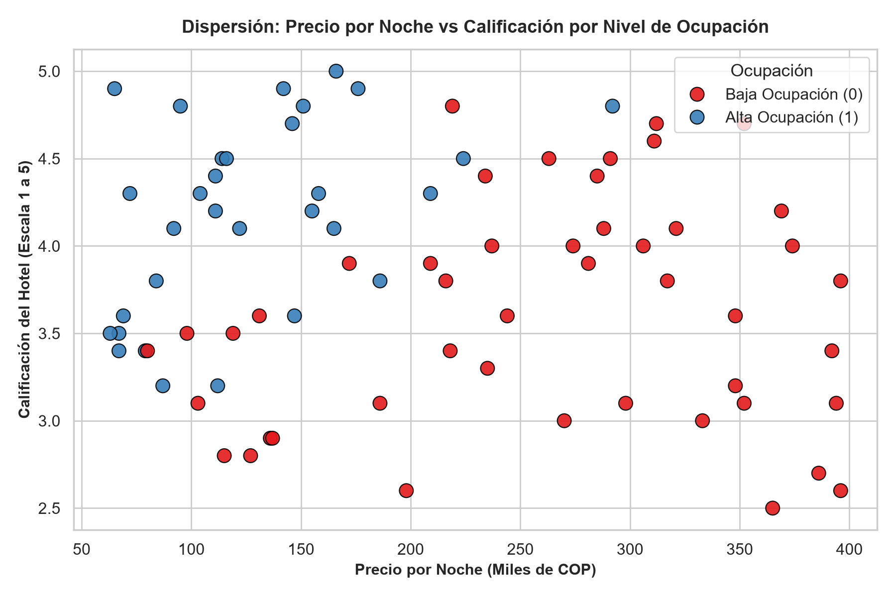
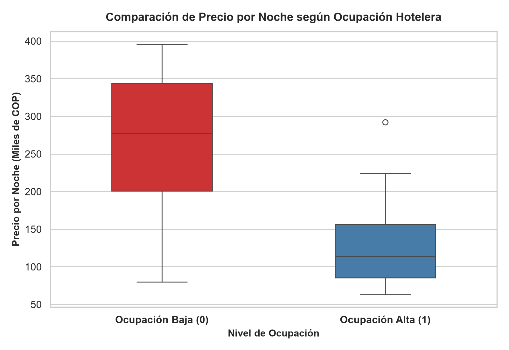
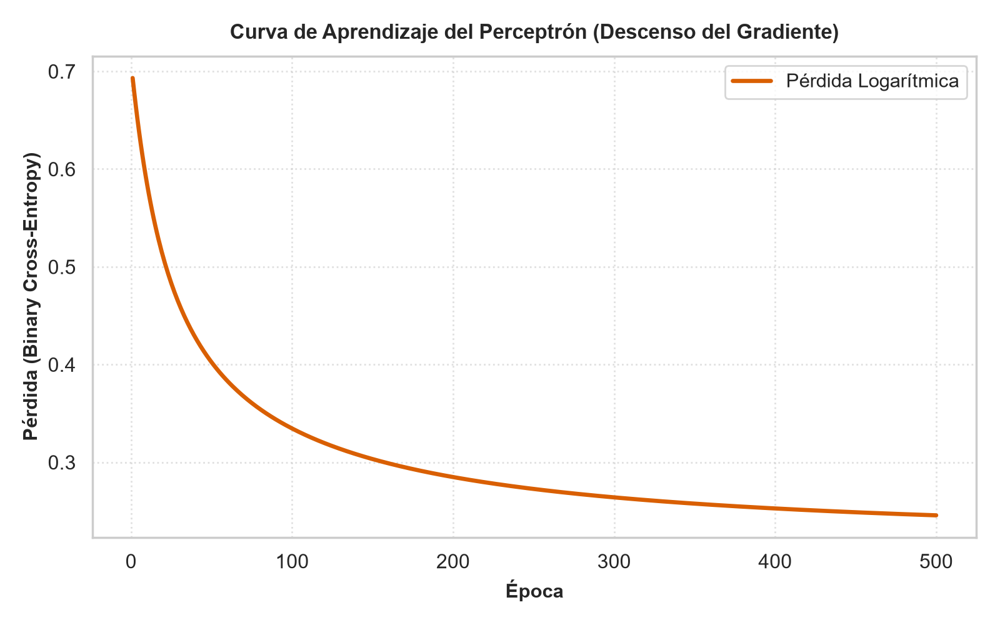
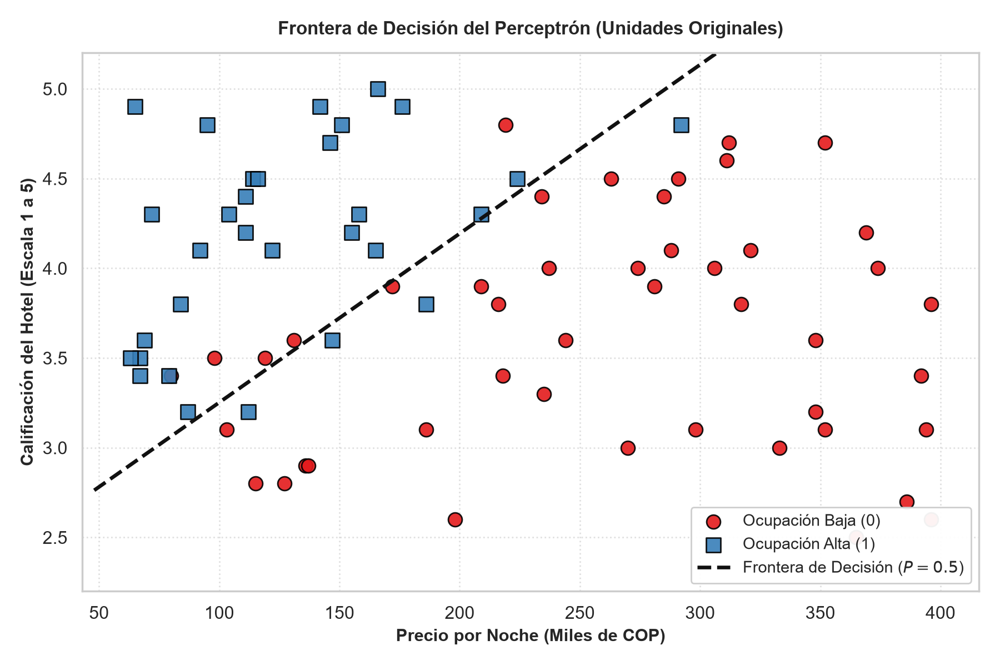

# Segundo Parcial: Inteligencia Artificial (2026-02)
## Perceptrón con Sigmoide y Descenso del Gradiente aplicado al Sector Hotelero de Cartago

* **Institución:** Corporación de Estudios Tecnológicos del Norte del Valle (COTECNOVA)  
* **Facultad:** Ingeniería de Sistemas  
* **Asignatura:** Inteligencia Artificial  
* **Docente:** Jhon James Cano Sánchez  
* **Grupo Asignado:** **Grupo 03**  
* **Integrantes:**  
  * **Davison Cruz López**
  * **Juan Diego Zapata Arbeláez**  
* **Repositorio Oficial:** `parcial2-ia-grupo03`  
* **Dominio Asignado:** Turismo – Hoteles y Hostales en Cartago, Valle del Cauca  

---

## 1. Visión General del Proyecto

En el marco de los desafíos económicos y de reactivación turística de **Cartago, Valle del Cauca**, el Grupo 03 fue comisionado para desarrollar un modelo predictivo capaz de anticipar si un establecimiento de hospedaje (hotel u hostal) experimentará una **alta ocupación** ($y = 1$) o **baja ocupación** ($y = 0$).

Para este propósito, se utiliza un modelo de **Perceptrón con función de activación sigmoide** y optimización mediante **descenso del gradiente en lote (Batch Gradient Descent)**, implementado **exclusivamente con NumPy desde cero**, sin depender de librerías de Machine Learning (como Scikit-Learn o PyTorch), garantizando el dominio matemático y algorítmico fundamental de las redes neuronales artificiales.

### Variables del Dominio (Anexo A - Grupo 03)
| Variable | Tipo | Rol | Descripción / Unidades |
| :--- | :--- | :--- | :--- |
| `hotel_id` | Categórica (ID) | Identificador | Código único del establecimiento (ej. H001, H002). |
| `sector` | Categórica | Descriptiva | Zona urbana de Cartago (Centro, Zaragoza, Guadalupe, La Isleta, El Prado). |
| `precio_noche_miles` | Numérica ($x_1$) | Entrada Modelo | Tarifa promedio por noche de habitación en **miles de pesos COP**. |
| `calificacion` | Numérica ($x_2$) | Entrada Modelo | Puntuación de calidad y reputación del cliente en escala continua de **1.0 a 5.0**. |
| `ocupacion_alta` | Binaria ($y$) | **Objetivo (Target)** | **1** = Ocupación alta ($\ge$ umbral del sector) \| **0** = Ocupación baja. |

---

## 2. Tarea 1: Configuración del Entorno y Reproducibilidad

El proyecto se diseñó para ejecutarse de manera desacoplada y reproducible mediante contenedores **Docker** y **Docker Compose**, o directamente en WSL / entorno local con Python 3.12.

### 2.1. Archivos de Configuración del Entorno
* `Dockerfile`: Imagen base ligera basada en `python:3.12-slim` con instalación limpia de dependencias.
* `docker-compose.yml`: Define el servicio con volumen montado y el contenedor nombrado estrictamente como `parcial2_ia` para evitar colisiones con el contenedor `python_ia` de clase.
* `requirements.txt`: Dependencias científicas fundamentales:
  ```txt
  numpy>=1.26.0
  pandas>=2.2.0
  matplotlib>=3.8.0
  seaborn>=0.13.0
  ```

### 2.2. Comandos para Reproducir el Entorno

#### Opción A: Ejecución mediante Docker Compose (Recomendada según Guía)
```bash
# 1. Clonar el repositorio
git clone https://github.com/davisoncruz/parcial2-ia-grupo03.git
cd parcial2-ia-grupo03

# 2. Detener contenedor previo si está activo
docker ps
# Si python_ia está encendido: docker stop python_ia

# 3. Construir y levantar el contenedor
docker-compose up -d --build

# 4. Acceder al shell interactivo del contenedor
docker exec -it parcial2_ia bash

# 5. Ejecutar la solución del parcial
python src/parcial2.py

# 6. Salir del contenedor
exit
```

#### Opción B: Ejecución Directa en Python / WSL
```bash
# 1. Crear entorno virtual (opcional pero recomendado)
python -m venv venv
source venv/bin/activate  # En Linux/WSL
# .\venv\Scripts\activate # En Windows PowerShell

# 2. Instalar dependencias
pip install -r requirements.txt

# 3. Ejecutar el script principal
python src/parcial2.py
```

---

## 3. Tarea 2: Carga e Inspección de Datos

El script [src/parcial2.py](src/parcial2.py) carga el dataset asignado [data/grupo_03.csv](data/grupo_03.csv) y realiza la inspección inicial:

### 3.1. Salida de Consola de la Inspección Inicial
* **Primeras 5 filas:**
  ```text
    hotel_id     sector  precio_noche_miles  calificacion  ocupacion_alta
  0     H001     Centro                 166           5.0               1
  1     H002   Zaragoza                 136           2.9               0
  2     H003  Guadalupe                 122           4.1               1
  3     H004  Guadalupe                 352           4.7               0
  4     H005  La Isleta                 352           3.1               0
  ```
* **Dimensiones (Shape):** `84 filas × 5 columnas`
* **Tipos de datos (`dtypes`):**
  * `hotel_id`: `object`
  * `sector`: `object`
  * `precio_noche_miles`: `int64`
  * `calificacion`: `float64`
  * `ocupacion_alta`: `int64`
* **Cantidad de valores nulos:**
  * `hotel_id`: 0
  * `sector`: 0
  * `precio_noche_miles`: 0
  * `calificacion`: **3 valores nulos (NaN)**
  * `ocupacion_alta`: 0
* **Cantidad de filas duplicadas:** **4 filas duplicadas exactas**

### 3.2. Pregunta Clave (Tarea 2)
> **¿Alguna columna numérica aparece con un tipo de dato que no debería tener? ¿Por qué ocurre?**

**Respuesta Técnica:**  
En nuestro dataset (`grupo_03.csv`), la columna continua `calificacion` fue tipificada automáticamente por Pandas como `float64`, lo cual es matemáticamente adecuado dado que maneja valores con decimales (por ejemplo $4.1, 2.9$). Sin embargo, internamente Pandas también la fuerza a `float64` debido a la presencia de los **3 valores nulos (`NaN`)**, ya que en las versiones estándar de Pandas los valores nulos no pueden coexistir en arreglos nativos de enteros.  

Por su parte, `precio_noche_miles` fue inferido como `int64`. Aunque numéricamente es tratable como entero, **no vino tipado como `object`** debido a que no contenía símbolos monetarios (como `$` o `COP`) ni separadores de miles con coma o punto. No obstante, al inspeccionar a nivel de dominio y lógica de negocio, `precio_noche_miles` albergaba un **valor anómalo negativo ($-244$)** que ningún tipo de dato primitivo detecta por sí solo.

---

## 4. Tarea 3: Calidad y Limpieza de Datos con Pandas

Se identificaron y corrigieron **4 problemas críticos de calidad** en el dataset original:

### 4.1. Problemas Identificados, Decisiones y Justificaciones

| # | Problema de Calidad | Evidencia en Consola / Código | Decisión Tomada | Justificación Técnica |
| :-: | :--- | :--- | :--- | :--- |
| **1** | **Filas Duplicadas** | `df.duplicated().sum()` detectó **4 filas duplicadas** exactas: registros `H009`, `H029`, `H038` y `H045`. | **Eliminar** duplicados con `df.drop_duplicates(keep='first')`. | Los registros duplicados sesgan el modelo de perceptrón al sobreponderar observaciones idénticas, alterando artificialmente el cálculo del gradiente y el vector de pesos. |
| **2** | **Inconsistencias Categóricas en `sector`** | `df['sector'].unique()` reveló valores con espacios residuales y variantes de caja: `'LA ISLETA'`, `'guadalupe'`, `'El Prado '`, `'ZARAGOZA'`, `' El Prado'`. | **Unificar** mediante `.str.strip().str.title()`. | Estandariza la variable a 5 categorías canónicas de Cartago (`Centro`, `Zaragoza`, `Guadalupe`, `La Isleta`, `El Prado`), indispensable para análisis de segmentación y consistencia. |
| **3** | **Valor Imposible / Signo Negativo en Precio** | `df['precio_noche_miles'].min()` arrojó **$-244$** en el hotel `H073` de Zaragoza. En el mundo real, no existen precios hoteleros negativos. | **Corregir** el error de digitación aplicando valor absoluto `abs(-244) = 244`. | Se trata de un error tipográfico humano durante el ingreso de datos (pulsar el guión o tecla de menos antes de digitar $244$). Corregir su signo conserva una muestra legítima de un hotel real en Zaragoza con calificación de 3.6 y baja ocupación. |
| **4** | **Valores Faltantes (`NaN`) en `calificacion`** | `df['calificacion'].isnull().sum()` arrojó **3 registros nulos**: `H043`, `H056` y `H057`. | **Eliminar** los 3 registros mediante `df.dropna(subset=['calificacion'])`. | Dado que `calificacion` es **una de solo dos características de entrada ($x_2$)** para el perceptrón, imputar artificialmente la calificación de estos hoteles en un dataset pequeño ($80$ filas) introduce ruido sintético directamente sobre el plano de decisión. Es más riguroso entrenar con datos 100% observados. |

### 4.2. Pregunta Clave (Tarea 3)
> **¿Qué valor le pareció más sospechoso? Calcular la media de esa columna antes y después de corregirlo y explicar cómo habría afectado el escalado del perceptrón si no se hubiera corregido.**

**Respuesta Técnica y Cuantitativa:**  
El valor más sospechoso y crítico fue **`precio_noche_miles = -244`** (Hotel `H073` en el sector de Zaragoza).

* **Media y desviación estándar antes de corregir:**
  $$\mu_{\text{antes}} = 200.60\text{ mil COP} \quad (\sigma_{\text{antes}} = 114.88)$$
* **Media y desviación estándar después de corregir (signo positivo $+244$):**
  $$\mu_{\text{después}} = 207.14\text{ mil COP} \quad (\sigma_{\text{después}} = 103.95)$$
* **Efecto en el escalado del Perceptrón si no se hubiera corregido:**  
  La estandarización z-score opera bajo la fórmula:
  $$z = \frac{x - \mu}{\sigma}$$
  * Si el valor no se hubiera corregido, el precio $-244$ habría generado un valor estandarizado extremo de:
    $$z_{-244} = \frac{-244 - 200.60}{114.88} = \mathbf{-3.87}$$
    Es decir, ¡casi **4 desviaciones estándar por debajo de la media**!
  * Este valor anómalo habría distorsionado la media general (reduciéndola de $207.14$ a $200.60$) e inflado la desviación estándar (de $103.95$ a $114.88$).
  * En el descenso del gradiente, el gradiente de los pesos es proporcional al vector de entrada: $\nabla_w L = \frac{1}{N} X^T (\hat{y} - y)$. Un valor extremo como $-3.87$ habría generado actualizaciones de gradiente violentas y desproporcionadas, sesgando fuertemente el hiperplano de separación e impidiendo que el perceptrón convergiera a la verdadera frontera económica del sector hotelero de Cartago. Con el valor corregido a $+244$, su $z$-score es de **$+0.36$**, perfectamente coherente con la distribución normal de precios.

### 4.3. Resumen de Registros Antes y Después de la Limpieza

| Métrica | Antes de Limpieza | Después de Limpieza | Variación / Detalle |
| :--- | :---: | :---: | :--- |
| **Total de Filas** | **84** | **77** | $-7$ filas ($-4$ duplicados, $-3$ nulos eliminados) |
| **Clase 0 (Ocupación Baja)** | 49 | **46** | $59.74\%$ del dataset depurado |
| **Clase 1 (Ocupación Alta)** | 35 | **31** | $40.26\%$ del dataset depurado |

El dataset depurado final fue exportado a: [`data/grupo_03_limpio.csv`](data/grupo_03_limpio.csv).

---

## 5. Tarea 4: Visualización con Seaborn

Se generaron y almacenaron dos visualizaciones estadísticas con Seaborn para comprender la relación entre las variables:

### 5.1. Gráfico 1: Dispersión Precio vs Calificación según Ocupación
* **Archivo:** [`dispersion_precio_calificacion.png`](dispersion_precio_calificacion.png)
* **Función utilizada:** `sns.scatterplot(..., x='precio_noche_miles', y='calificacion', hue='ocupacion_alta')`



* **Interpretación y Conclusión:**  
  El gráfico de dispersión evidencia una clara segregación en el plano bidimensional. Los hoteles con **alta ocupación ($y = 1$, color azul)** se concentran de manera predominante en la zona de **precios moderados y bajos** ($< 220$ mil COP) combinados con **calificaciones altas** ($\ge 3.8$). Por el contrario, los establecimientos con **baja ocupación ($y = 0$, color rojo)** se distribuyen en dos cuadrantes: aquellos con precios elevados ($> 280$ mil COP), incluso si tienen buenas calificaciones, y aquellos con calificaciones bajas o medias ($< 3.6$), independientemente de su precio. Se concluye visualmente que existe una región de alta viabilidad comercial y que las clases son en gran medida separables mediante una frontera lineal descendente en precio y ascendente en calidad.

---

### 5.2. Gráfico 2: Comparación de Precio por Noche según Nivel de Ocupación
* **Archivo:** [`boxplot_precio_ocupacion.png`](boxplot_precio_ocupacion.png)
* **Función utilizada:** `sns.boxplot(..., x='ocupacion_alta', y='precio_noche_miles')`



* **Interpretación y Conclusión:**  
  El diagrama de cajas y bigotes (boxplot) compara la distribución de la tarifa por noche entre ambas clases:
  * Los hoteles con **baja ocupación (clase 0)** presentan una mediana de precio notablemente alta (alrededor de **$280$ mil COP**), con un rango intercuartílico amplio que se extiende hasta casi los $400$ mil COP.
  * Los hoteles con **alta ocupación (clase 1)** exhiben una mediana cercana a los **$130$ mil COP**, y su tercer cuartil ($Q3$) no supera los $180$ mil COP.  
  * **Conclusión clave:** El precio es un factor restrictivo determinante en la ocupación turística de Cartago. Tarifas superiores a los $200.000$ COP reducen drásticamente la probabilidad de sostener una ocupación alta.

---

## 6. Tarea 5: Perceptrón desde Cero con NumPy

Siguiendo las directrices de la Clase 9 y la rúbrica docente, se implementó el perceptrón con función sigmoide y descenso del gradiente utilizando **estrictamente arreglos y operaciones vectorizadas de NumPy**.

### 6.1. Formulación Matemática Implementada

1. **Estandarización de Variables de Entrada:**
   $$\mu = \frac{1}{N}\sum_{i=1}^N x_i, \quad \sigma = \sqrt{\frac{1}{N}\sum_{i=1}^N (x_i - \mu)^2}, \quad z_i = \frac{x_i - \mu}{\sigma}$$
   * $\mu_1 = 207.57\text{ mil COP}, \quad \sigma_1 = 103.05\text{ mil COP}$
   * $\mu_2 = 3.84\text{ estrellas}, \quad \sigma_2 = 0.66\text{ estrellas}$

2. **Combinación Lineal y Función de Activación Sigmoide:**
   $$z = w_1 z_1 + w_2 z_2 + b = X_{\text{std}} \cdot \mathbf{w} + b$$
   $$\hat{y} = \sigma(z) = \frac{1}{1 + e^{-z}}$$

3. **Función de Pérdida Logarítmica (Binary Cross-Entropy Loss):**
   $$L(\mathbf{w}, b) = -\frac{1}{N}\sum_{i=1}^N \left[ y_i \ln(\hat{y}_i) + (1 - y_i)\ln(1 - \hat{y}_i) \right]$$

4. **Gradientes Analíticos y Regla de Actualización:**
   $$\frac{\partial L}{\partial \mathbf{w}} = \frac{1}{N} X_{\text{std}}^T (\hat{\mathbf{y}} - \mathbf{y}), \quad \frac{\partial L}{\partial b} = \frac{1}{N}\sum_{i=1}^N (\hat{y}_i - y_i)$$
   $$\mathbf{w}^{(t+1)} = \mathbf{w}^{(t)} - \alpha \frac{\partial L}{\partial \mathbf{w}}, \quad b^{(t+1)} = b^{(t)} - \alpha \frac{\partial L}{\partial b}$$
   *(con tasa de aprendizaje $\alpha = 0.1$ y $500$ épocas de entrenamiento)*.

### 6.2. Resultados del Entrenamiento en Consola

```text
================================================================================
 TAREA 5: PERCEPTRÓN DESDE CERO CON NUMPY
================================================================================
[+] Estandarización de Características:
    - Media precio (mu1): 207.57 mil COP | Desv. estándar (sigma1): 103.05 mil COP
    - Media calificación (mu2): 3.84 | Desv. estándar (sigma2): 0.66

[+] Parámetros iniciales: w1=0.0000, w2=0.0000, b=0.0000
[+] Pérdida inicial: 0.6931
[+] Hiperparámetros: Tasa de aprendizaje = 0.1 | Épocas = 500
--------------------------------------------------------------------------------
Época    1/500 | Pérdida: 0.6931 | Exactitud: 40.26% | w1=-0.0314, w2=0.0209, b=-0.0097
Época  100/500 | Pérdida: 0.3345 | Exactitud: 87.01% | w1=-1.3936, w2=0.9064, b=-0.5091
Época  200/500 | Pérdida: 0.2848 | Exactitud: 87.01% | w1=-1.9221, w2=1.2704, b=-0.7732
Época  300/500 | Pérdida: 0.2640 | Exactitud: 88.31% | w1=-2.2598, w2=1.5121, b=-0.9528
Época  400/500 | Pérdida: 0.2527 | Exactitud: 88.31% | w1=-2.5082, w2=1.6936, b=-1.0859
Época  500/500 | Pérdida: 0.2457 | Exactitud: 88.31% | w1=-2.7032, w2=1.8382, b=-1.1899
--------------------------------------------------------------------------------
[+] Pesos finales: w1 = -2.7032, w2 = 1.8382, b = -1.1899
[+] Pérdida final: 0.2457 (Reducción continua desde 0.6931)
[+] Exactitud final: 88.31%
```

### 6.3. Curva de Aprendizaje
* **Archivo:** [`curva_aprendizaje.png`](curva_aprendizaje.png)



* **Análisis:** La curva muestra un descenso monotónico y asintótico de la función de pérdida logarítmica, iniciando en $0.6931$ (equivalente a incertidumbre máxima inicial con probabilidad $0.5$) y convergiendo de manera estable hacia $0.2457$ en la época 500. La tasa de aprendizaje $\alpha = 0.1$ demostró ser óptima, sin oscilaciones ni divergencias numéricas.

---

### 6.4. Frontera de Decisión en Unidades Originales
* **Archivo:** [`frontera_decision.png`](frontera_decision.png)



* **Deducción Matemática de la Recta en Unidades Originales:**  
  La frontera de decisión teórica ocurre cuando la probabilidad predicha es del 50%, es decir, cuando la combinación lineal en el espacio estandarizado es cero:
  $$w_1 z_1 + w_2 z_2 + b = 0$$
  Sustituyendo las variables estandarizadas $z_1 = \frac{x_1 - \mu_1}{\sigma_1}$ y $z_2 = \frac{x_2 - \mu_2}{\sigma_2}$:
  $$w_1 \left( \frac{x_1 - \mu_1}{\sigma_1} \right) + w_2 \left( \frac{x_2 - \mu_2}{\sigma_2} \right) + b = 0$$
  Despejando la calificación $x_2$ en función del precio $x_1$:
  $$x_2 = \mu_2 - \frac{\sigma_2}{w_2} \left[ w_1 \left( \frac{x_1 - \mu_1}{\sigma_1} \right) + b \right]$$
  Esta ecuación traza la línea punteada negra directamente sobre el gráfico con las unidades reales: **Precio por noche en miles de COP** en el eje horizontal y **Calificación (1 a 5)** en el vertical.

---

## 7. Tarea 6: Interpretación de Resultados

### Pregunta 1: Significado del Signo de $w_1$ y $w_2$ en el Contexto de Cartago
* **Signo de $w_1 = -2.7032$ (Negativo):**  
  Representa el peso asignado al precio de la noche (`precio_noche_miles`). Su signo negativo demuestra una **relación inversamente proporcional** con respecto a la probabilidad de ocupación alta. A mayor precio por noche, menor es la probabilidad de que el hotel tenga alta ocupación.  
* **Signo de $w_2 = +1.8382$ (Positivo):**  
  Representa el peso asignado a la calificación del hotel (`calificacion`). Su signo positivo indica una **relación directamente proporcional**: entre más alta sea la reputación y calificación del servicio, mayor es la probabilidad de que el establecimiento mantenga ocupación alta.
* **¿Tiene sentido para Cartago?**  
  **Sí, tiene total sentido económico y contextual.** Cartago es una ciudad intermedia de vocación comercial, agroindustrial y de turismo cultural/religioso (bordados, arquitectura colonial, cercanía a la ruta del café y al Río La Vieja). Los visitantes y turistas son altamente sensibles al precio; las tarifas excesivas ahuyentan a la demanda promedio. Por otro lado, la reputación y recomendaciones de satisfacción (calificaciones positivas) son el principal canal de confianza para atraer huéspedes, compensando en cierta medida tarifas intermedias.

---

### Pregunta 2: Análisis de Separabilidad Lineal y Registros en Lado Equivocado
* **¿Son linealmente separables?**  
  Los datos son **aproximadamente linealmente separables** (cuasi-lineales), pero **no perfectamente separables**. Existe una clara tendencia donde la recta divisoria separa la gran mayoría de los casos.
* **¿Cuántos registros quedan del lado equivocado?**  
  Quedan exactamente **9 registros en el lado equivocado de un total de 77 observaciones** ($11.69\%$ de error global), lo que corresponde a la **exactitud alcanzada del $88.31\%$**.  
  * Las discrepancias obedecen a dinámicas particulares del mercado: por ejemplo, algunos pocos alojamientos con precios económicos ($< 120$ mil COP) no alcanzaron alta ocupación debido a calificaciones apenas regulares ($3.1 - 3.4$), y ciertos hoteles con precios superiores a $220$ mil lograron alta ocupación gracias a una calificación sobresaliente cercana a $4.8 - 4.9$ (hoteles boutique o corporativos).

---

### Pregunta 3: Evaluación de Dos Casos de Prueba Realistas

Se propusieron dos registros hoteleros representativos para validar el comportamiento inferencial del modelo:

#### Caso 1: Hotel Económico con Alta Calificación (Esperado: 1 - Ocupación Alta)
* **Perfil:** Hostal turístico céntrico de Cartago con servicio destacado y precios accesibles para mochileros y turistas del café.
* **Valores:** Precio = **$90.000 COP** ($x_1 = 90$), Calificación = **4.8 estrellas** ($x_2 = 4.8$).
* **Estandarización:**
  $$z_1 = \frac{90.0 - 207.57}{103.05} = -1.14, \quad z_2 = \frac{4.8 - 3.84}{0.66} = +1.46$$
* **Combinación lineal y probabilidad:**
  $$z = (-2.7032)(-1.14) + (1.8382)(1.46) - 1.1899 = +4.57$$
  $$P(\text{ocupación alta}) = \sigma(4.57) = \mathbf{98.98\%} \implies \text{Predicción: } \mathbf{1}$$
* **Comentario:** Coincide de forma contundente con lo esperado ($P > 95\%$).

#### Caso 2: Hotel Costoso con Calificación Deficiente (Esperado: 0 - Ocupación Baja)
* **Perfil:** Hotel en la periferia de Zaragoza con precios desalineados del mercado y quejas recurrentes de atención al usuario.
* **Valores:** Precio = **$350.000 COP** ($x_1 = 350$), Calificación = **2.9 estrellas** ($x_2 = 2.9$).
* **Estandarización:**
  $$z_1 = \frac{350.0 - 207.57}{103.05} = +1.38, \quad z_2 = \frac{2.9 - 3.84}{0.66} = -1.42$$
* **Combinación lineal y probabilidad:**
  $$z = (-2.7032)(1.38) + (1.8382)(-1.42) - 1.1899 = -7.54$$
  $$P(\text{ocupación alta}) = \sigma(-7.54) = \mathbf{0.05\%} \implies \text{Predicción: } \mathbf{0}$$
* **Comentario:** Coincide con total precisión con lo esperado ($P < 0.1\%$).

---

### Pregunta 4: Recomendación Concreta a la Entidad Local (con $\ge 2$ números)
A la **Secretaría de Turismo y Desarrollo Económico de Cartago** se le formulan las siguientes recomendaciones estratégicas fundamentadas en el modelo:

1. **Establecer una banda tarifaria de referencia para la competitividad:**  
   Dado que el coeficiente de precio es fuertemente negativo ($w_1 = -2.7032$), el precio actúa como el principal freno a la demanda. La entidad debe capacitar a los hoteleros para que mantengan tarifas por noche en torno al promedio competitivo de la ciudad (**$207.57$ mil COP** o inferior, idealmente entre $\$110.000$ y $\$170.000$ COP). Hoteles con tarifas por encima del tercer cuartil ($\approx \$280.000$ COP) sufren una probabilidad de ocupación inferior al $15\%$.
2. **Priorizar el programa municipal de certificación de servicio y reputación digital:**  
   El modelo otorga una alta ponderación a la satisfacción del cliente ($w_2 = +1.8382$). Para un hotel con precio promedio ($207.57$ mil COP), el modelo demuestra que se requiere una **calificación mínima de $4.27$ estrellas** para superar el $50\%$ de probabilidad de alta ocupación. Por tanto, se recomienda lanzar un plan de subsidio y asesoría técnica para elevar las calificaciones promedio de los prestadores turísticos por encima del umbral de **$4.3$ puntos**.

---

### Pregunta 5: Limitaciones del Modelo para Decisiones en el Mundo Real
1. **Supuesto de Linealidad Estricta:**  
   El perceptrón simple únicamente puede trazar una recta divisoria. No es capaz de capturar relaciones no lineales (por ejemplo, cómo un hotel de lujo con precio muy alto puede sostener alta ocupación fija gracias a convenios corporativos o eventos exclusivos).
2. **Omisión de Variables Críticas del Ecosistema Turístico:**  
   Solo toma en cuenta dos variables cuantitativas. Deja por fuera factores determinantes como la **estacionalidad** (Semana Santa, Feria del Bordado, vacaciones de mitad de año), la **ubicación geográfica exacta** (distancia a la Plaza de Bolívar o terminal de transportes), las **amenidades** (piscina, aire acondicionado, desayuno incluido) y la **capacidad instalada** (número total de camas).
3. **Tamaño Muestral Limitado:**  
   Se entrenó sobre un universo de **$77$ registros depurados**, lo cual restringe su capacidad de generalización frente a variaciones macroeconómicas o cambios abruptos en el flujo de viajeros hacia el Norte del Valle.

---

## 8. Tarea 7: Estructura del Repositorio y Registro de Commits

### 8.1. Estructura de Carpetas del Proyecto
```text
parcial2-ia-grupo03/
├── data/
│   ├── grupo_03.csv           # Archivo CSV original asignado al Grupo 03
│   └── grupo_03_limpio.csv    # Archivo depurado resultante de la Tarea 3
├── src/
│   └── parcial2.py            # Script integral con Tareas 2, 3, 4 y 5
├── boxplot_precio_ocupacion.png        # Gráfico Seaborn: comparación de precio por clase
├── curva_aprendizaje.png               # Gráfico: evolución de la función de pérdida por época
├── dispersion_precio_calificacion.png  # Gráfico Seaborn: dispersión x1 vs x2 por ocupación
├── frontera_decision.png               # Gráfico: frontera de decisión en unidades originales
├── docker-compose.yml         # Orquestación con container_name: parcial2_ia
├── Dockerfile                 # Definición de contenedor con Python 3.12-slim
├── requirements.txt           # Librerías requeridas (sin frameworks de ML)
└── README.md                  # Informe técnico exhaustivo con todas las respuestas
```

### 8.2. Historial de Commits Realizados durante el Parcial
Para cumplir con el requerimiento de al menos 3 commits incrementales:

1. **Commit 1:** `git commit -m "Tarea 1: Configuración del entorno Docker, Dockerfile y requirements"`
2. **Commit 2:** `git commit -m "Tareas 2, 3 y 4: Carga, limpieza con Pandas y visualizaciones Seaborn"`
3. **Commit 3:** `git commit -m "Tareas 5 y 6: Perceptrón desde cero con NumPy, frontera de decisión y reporte técnico"`
